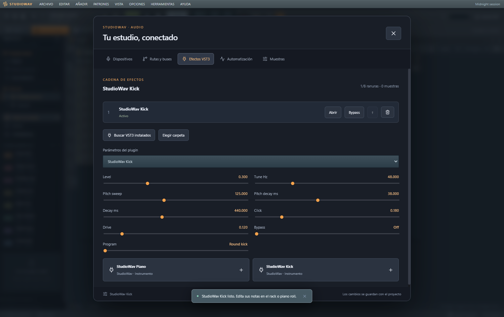
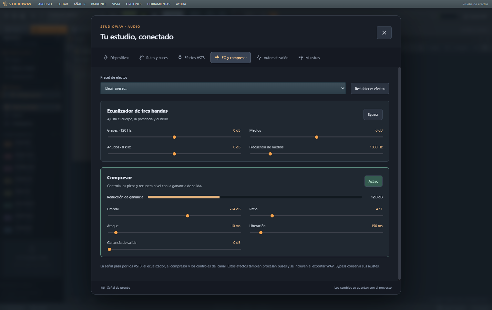

# StudioWav 0.7

DAW de escritorio para Windows con piano y kick VST3 propios, biblioteca de plugins instalados, patrones con varios instrumentos, Playlist independiente y herramientas de edición musical. Conserva el motor C++ propio, ASIO/WASAPI, grabación, entrada MIDI y efectos VST3. REA se utilizó para investigar formatos y controles de FL Studio; la síntesis y el procesamiento son implementaciones propias.

La versión 0.7 añade **ecualizador de tres bandas y compresor por canal y bus**, con presets propios, bypass independiente y medidor de reducción real. Abre **F10 → EQ y compresor** o usa el acceso del mezclador. Los efectos se guardan con el proyecto y se incluyen en el WAV. [Funcionamiento y pruebas](docs/channel-effects.md).

También puedes **importar y exportar archivos MIDI**: selección de partes, notas editables, percusión GM por voz, pedal sustain convertido a duración y exportación del patrón o la canción. Abre **Archivo → Importar MIDI…** o arrastra un `.mid` al editor. [Compatibilidad, límites y pruebas](docs/midi.md).

## Abrir

Descarga el portable para Windows x64 desde [GitHub Releases](https://github.com/Lumarri/StudioWav/releases). Incluye el motor y los dos instrumentos VST3 propios; no requiere instalar Node.js, Python ni herramientas de compilación. El ejecutable no está firmado. Si compilas el proyecto, **Abrir StudioWav.cmd** inicia la distribución local de la versión 0.7.0.

Pulsa **F8** y elige **StudioWav Piano** o **StudioWav Kick** para añadirlo al rack. Usa el botón de escucha del canal para probarlo. En **F10 → Efectos VST3 → Abrir** están el editor y sus cuatro presets. En ese panel también puedes ajustar parámetros o cargar efectos instalados. F8 permite buscar otros instrumentos VST3 sin mover sus archivos.

Abre [examples/Piano y kicks.studiowav](<examples/Piano y kicks.studiowav>) con **Abrir proyecto** para escuchar un arreglo listo de ocho compases. El ejemplo también se incluye en `resources/examples` de la distribución extraída.

También se incluye [Piano y kicks.mid](<examples/Piano y kicks.mid>) para probar el intercambio de notas con otros programas.

[Mezcla con efectos.studiowav](<examples/Mezcla con efectos.studiowav>) permite escuchar los nuevos procesadores con Piano y Kick.

**FL Keys y Fruit Kick no se pueden trasladar como VST3:** REA confirmó que las DLL instaladas usan la interfaz nativa de FL Studio. Los instrumentos incluidos son propios. La biblioteca busca los VST3 instalados en tu equipo y conserva su catálogo; se cargan desde sus rutas originales y no se redistribuyen. [Origen del código y método de investigación](docs/research-method.md).

Pulsa **F10** o el botón con deslizadores junto al nombre del proyecto para configurar dispositivos, grabar, crear rutas, cargar efectos y editar automatización o muestras.

## Funciones

- Un clip de patrón reproduce todos los canales que contienen pasos o notas. Moverlo a otra pista de Playlist conserva los instrumentos y sus rutas al mezclador. Silenciar la pista afecta a sus clips en modo canción; silenciar un canal del mezclador afecta al instrumento.
- Playlist con hasta 32 pistas independientes de los instrumentos. Añadir una pista no crea un sintetizador; añadir un bus tampoco crea una pista de Playlist.
- Clips compartidos, **Hacer único**, duplicar y extender bucles. Editar un patrón modifica sus copias; hacer único clona su contenido para aislar solo ese clip. Clic derecho sigue eliminando clips.
- Patrones de 16, 32, 64 o 128 pasos; rejilla y duración de nota hasta 1/64. Los tiempos y duraciones fraccionarios llegan al renderizador nativo.
- **Herramientas** del Piano Roll: cuantización con rejilla/fuerza, arpegios con dirección/octavas/gate, articulación legato/gate, troceado, inversión temporal/de alturas e inserción de acordes. Muestran el resultado, permiten escucharlo y crean un paso de deshacer al aceptar; cancelar conserva el original.
- Ctrl+clic o Mayús+clic selecciona varias notas; arrastrar mueve el grupo. Ctrl+A selecciona todas, Ctrl+C/X/V copia/corta/pega y Ctrl+B duplica después del grupo. Las herramientas actúan sobre la selección; sin selección actúan sobre todo el canal.
- **Patrones → Separar por canales** crea patrones individuales de los canales con contenido; conserva el original y sus clips existentes.
- Ventanas independientes: mover por la cabecera, redimensionar desde la esquina, maximizar con doble clic, ocultar y recuperar. Su posición y tamaño se conservan localmente; **Restablecer ventanas** recupera el diseño inicial.
- Menús Archivo, Editar, Añadir, Patrones, Vista, Opciones, Herramientas y Ayuda con acciones y navegación por teclado.
- Navegador con proyecto, patrones y sonidos. Arrastrar un patrón a una pista de Playlist coloca el patrón arrastrado.
- Menú contextual del canal: Piano Roll, ajustes, rellenar cada 2/4/8 pasos, copiar, pegar y vaciar, con deshacer.
- Controles giratorios de volumen y panorama en el rack; arrastra verticalmente, usa las flechas al enfocarlos o haz doble clic para restablecer.
- Notas fantasma, transposición por octavas y edición de velocidad desde el carril inferior del Piano Roll.
- Panel lateral del mezclador con ocho ranuras VST3: acceso al editor, bypass, salida y rutas del canal seleccionado.
- Secuenciador de longitud variable, tempo de 40 a 240 BPM y swing.
- Piano roll con movimiento, duración y velocidad de notas; teclado musical A–K.
- Arreglo de patrones y clips de audio; ocho instrumentos propios de batería, bajo, teclas y pad.
- Motor nativo por bloques con eventos posicionados en muestras, transporte y medidores procedentes del proceso de audio.
- ASIO, WASAPI compartido, exclusivo y de baja latencia, y DirectSound, según los dispositivos instalados.
- Selección de salida, entrada, frecuencia y búfer; panel del controlador y preferencias persistentes.
- Volumen, panorama, mute, solo, filtro paso bajo y delay sincronizado.
- EQ de graves, medios ajustables y agudos; compresor estéreo con umbral, ratio, ataque, liberación, ganancia de salida y medidor. Funcionan en canales y buses, con presets, bypass, deshacer y guardado.
- Buses, salida por canal y envíos. El ruteo rechaza ciclos de realimentación.
- Compensación de latencia para las rutas que se suman: retardos de canal y latencia declarada por los VST3, actualizada cuando cambia esa declaración.
- Hasta ocho VST3 estéreo por canal: búsqueda, carga, bypass, orden, editor nativo, parámetros y estado guardado en el proyecto. Los instrumentos VST3 reciben las notas del canal.
- Automatización interpolada de volumen, panorama, filtro y envío al delay.
- Grabación de entrada o master a WAV estéreo de 24 bits, con escritura en un hilo separado e incorporación de la toma al arreglo.
- Entrada MIDI externa y grabación cuantizada de notas en el patrón seleccionado.
- Importación de WAV, MP3, OGG, FLAC y formatos compatibles con ambos decodificadores; hasta 100 MB y diez minutos por muestra.
- Editor de muestras con forma de onda, recorte, inversión, normalización y fundidos, con deshacer.
- Exportación WAV estéreo PCM de 16 bits / 44,1 kHz desde el mismo procesamiento nativo de reproducción, con tres segundos de cola.
- Proyectos .studiowav con audio incluido, guardado local automático y 50 pasos de deshacer/rehacer.

Las tomas originales también permanecen en **Recordings**, dentro de los datos de usuario. Usa **Audio → Abrir grabaciones** para acceder a ellas. Si una toma supera el límite de importación, su WAV permanece allí.

## Flujo de trabajo

1. Abre la demostración y pulsa Espacio para reproducir.
2. Selecciona un instrumento en el Channel Rack; programa pasos o abre el Piano Roll. Arrastra un patrón del navegador a la Playlist para reproducir todos sus canales. Mover el clip entre pistas no cambia los instrumentos.
3. En **Audio → Rutas y buses**, añade un bus y dirige canales a él, o crea envíos. Selecciona el bus en el mezclador para ajustar su nivel y sus efectos.
4. En **Efectos VST3**, busca los instalados o elige su carpeta. Abre el editor del plugin o sus parámetros.
5. En **Automatización**, elige un control y guarda puntos. En modo patrón se repiten según la longitud del patrón activo.
6. Para grabar, elige entrada o master y pulsa **Grabar**. Puedes cerrar el panel y reproducir mientras continúa la toma. Vuelve al panel y pulsa **Finalizar toma**.
7. Para grabar MIDI, selecciona su dispositivo en Audio, arma **Grabar MIDI** y reproduce.
8. Guarda un archivo .studiowav para conservar una copia transportable. El estado VST3 se captura al guardar y al cerrar normalmente la aplicación; también se actualiza periódicamente en el guardado local.

Para variar solo una repetición, selecciona su clip y pulsa **Hacer único**. Para transformar notas, abre **Herramientas** en el Piano Roll, ajusta parámetros, escucha el resultado y pulsa **Aceptar herramienta**. **Cancelar** conserva las notas originales; **Ctrl+Z** deshace una transformación aceptada.

## Atajos

| Tecla                     | Acción                      |
| ------------------------- | --------------------------- |
| Espacio                   | Reproducir / pausar         |
| F5 / F6 / F7 / F9          | Playlist / rack / Piano Roll / mezclador |
| F8 / F10 / F1             | Instrumentos / audio y MIDI / ayuda |
| Ctrl+L / Ctrl+T           | Alternar canción-patrón / teclado musical |
| Ctrl+N / Ctrl+E           | Nuevo proyecto / exportar WAV |
| Ctrl+Q                    | Cuantizar notas a la rejilla del Piano Roll |
| Alt+Q / Alt+A             | Cuantizador / arpegiador con parámetros |
| Alt+L / Alt+U / Alt+Y      | Articulador / trocear / invertir |
| Ctrl+L en Piano Roll      | Legato rápido de la selección o el canal |
| Ctrl+A / Ctrl+C/X/V / Ctrl+B | Seleccionar / copiar-cortar-pegar / duplicar notas |
| Ctrl+↑ / Ctrl+↓           | Transponer el canal una octava en Piano Roll |
| Esc                       | Detener o cerrar un diálogo |
| A W S E D F T G Y H U J K | Tocar una octava            |
| Ctrl+S / Ctrl+O           | Guardar / abrir proyecto    |
| Ctrl+Z / Ctrl+Y           | Deshacer / rehacer          |
| Supr                      | Borrar la nota seleccionada |

En el arreglo: clic para añadir, arrastrar para mover y clic derecho para borrar. En el piano roll, arrastra el borde derecho de una nota para cambiar su duración.

## Alcance

El motor y los instrumentos son implementaciones propias. La investigación de FL Studio orientó la separación entre dispositivo, mezcla y renderizado; no se recuperó ni se incorporó su algoritmo DSP.

La interfaz 0.3 se basa en la [investigación de recursos y ventanas](docs/research-method.md). La versión 0.4 añade [investigación y pruebas funcionales](docs/research-method.md). Los nuevos clips son patrones completos; los proyectos antiguos mantienen sus clips por instrumento para conservar el sonido. No abre .flp ni incorpora plugins, código o recursos gráficos de Image-Line; utiliza proyectos .studiowav.

Las herramientas son implementaciones propias del comportamiento descrito. No cargan plantillas .fsc/grooves de FL ni reproducen su generador de progresiones, modulaciones por nota o todos sus modos de sincronización. Acortar un patrón recorta las notas y pasos posteriores, y puede deshacerse. Las copias individuales creadas por **Separar por canales** no reemplazan automáticamente los clips existentes.

Esta versión procesa dos canales principales por plugin y admite 32 pistas, incluidos los buses. No incluye VST2, salida MIDI externa, grabación multipista simultánea, time stretching ni automatización de parámetros VST. Los plugins ausentes o incompatibles producen un error al cargar la cadena. Reconstruir el grafo puede interrumpir brevemente el audio; el contador informa bloques perdidos o fuera de plazo. No se promete compatibilidad con todos los drivers o plugins.

Las muestras decodificadas tienen un presupuesto de 512 MB y el ruteo permite ocho segundos de latencia acumulada. El guardado local depende de la cuota del navegador y no sustituye el archivo del proyecto.

La interfaz en navegador utiliza Web Audio de compatibilidad. ASIO, VST3, grabación de dispositivos y MIDI requieren Windows; ambos backends no producen resultados idénticos.

## Desarrollo

Requiere Node.js 24 o 26, Python 3 y CMake 3.22 o posterior. La preparación descarga paquetes oficiales de Microsoft, Ninja y JUCE dentro de native/, sin cambiar el PATH global ni requerir administrador.

    npm.cmd ci
    npm.cmd run native:setup
    npm.cmd run native:build
    npm.cmd run desktop

Para generar el portable: **npm.cmd run dist**. Para la interfaz de compatibilidad: **npm.cmd run dev**.

    npm.cmd test
    npm.cmd exec playwright install chromium
    npm.cmd run test:e2e
    npm.cmd run test:native
    node scripts/verify-desktop.mjs
    node scripts/verify-musical-engine.mjs
    node scripts/verify-instruments.mjs
    node scripts/verify-plugin-desktop.mjs
    node scripts/verify-midi.mjs
    node scripts/verify-midi-desktop.mjs
    node scripts/verify-channel-effects.mjs
    node scripts/verify-effects-desktop.mjs

La suite nativa usa un VST3 de prueba compilado con el proyecto y WAV reales. Electron se verifica con un perfil temporal aislado. Los resultados quedan en test-results/.

## Código y evidencias

- [native/Engine.cpp](native/Engine.cpp): dispositivos, DSP, plugins, ruteo, grabación y exportación.
- [electron/native.cjs](electron/native.cjs): proceso de audio, comunicación y tomas.
- [src/audio/desktop-engine.ts](src/audio/desktop-engine.ts): conexión del editor con el backend.
- [src/model.ts](src/model.ts): proyectos, eventos, validación y automatización.
- [src/AudioPanel.tsx](src/AudioPanel.tsx) y [src/SampleEditor.tsx](src/SampleEditor.tsx): estudio y edición.
- [src/WorkspaceWindow.tsx](src/WorkspaceWindow.tsx), [src/StudioMenu.tsx](src/StudioMenu.tsx) y [src/workspace.css](src/workspace.css): ventanas, menús y aspecto de la versión 0.3.
- [docs/audio-engine.md](docs/audio-engine.md): arquitectura y verificación.
- [Investigación REA](docs/research-method.md): evidencias y límites.
- [Interfaz investigada con REA](docs/research-method.md): recursos de formularios, capturas y correspondencia con la implementación.
- [Avisos de terceros](THIRD_PARTY_NOTICES.md): dependencias y licencias.

## Licencia y contribuciones

Copyright (c) 2026 Lumarri y los contribuidores de StudioWav.

El código propio de StudioWav se publica bajo **AGPL-3.0-only**; consulta [LICENSE](LICENSE). Las dependencias conservan sus licencias y atribuciones, enumeradas en [THIRD_PARTY_NOTICES.md](THIRD_PARTY_NOTICES.md). Los archivos de JUCE y el SDK de compilación se descargan durante la preparación y no están versionados en este repositorio. `private: true` en package.json evita publicar accidentalmente el paquete en npm; el repositorio y su código son públicos.

Consulta [CONTRIBUTING.md](CONTRIBUTING.md) para colaborar. Puedes reportar errores en [Issues](https://github.com/Lumarri/StudioWav/issues).

