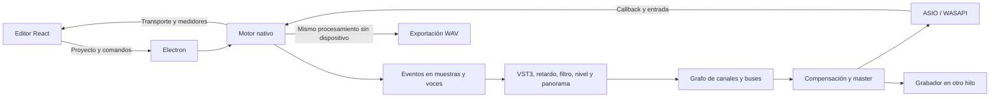

# Motor de audio de StudioWav 0.5

La versión 0.5 incorpora instrumentos VST3 propios y corrige el bypass de generadores. La compilación de eventos admite clips de patrón multicanal, pistas de Playlist independientes, bucles, longitudes de 16/32/64/128 pasos y notas en tiempos fraccionarios. `scripts/verify-musical-engine.mjs` y `scripts/verify-instruments.mjs` comprueban estos comportamientos contra PCM real del renderizador.

Windows ejecuta StudioWavAudio.exe, un proceso C++ x64 basado en JUCE 8.0.12. Electron conserva la interfaz y los archivos de usuario. La comunicación usa JSON por los canales estándar del proceso hijo; el callback de audio no serializa JSON ni accede al DOM.

## Procesamiento

Los eventos se compilan a posiciones y duraciones en muestras. Cada callback coloca los eventos dentro de su bloque, procesa las voces y entrega MIDI a los plugins. El reloj avanza por muestras procesadas. El temporizador de interfaz solo recibe observaciones.

Los canales usan buffers preasignados, hasta 64 voces propias y ocho VST3 estéreo. El filtro nativo contiene dos etapas de paso bajo; volumen y panorama se suavizan para reducir discontinuidades.

El mezclador ordena las conexiones y rechaza ciclos. En cada canal calcula la mayor latencia de sus predecesores y retrasa las rutas más cortas. El mismo criterio se aplica a entradas locales y master. Las declaraciones de latencia VST3 se consultan al actualizar el estado y provocan un nuevo cálculo cuando cambian. La latencia del dispositivo se informa aparte: procede del driver y no de una medición física de ida y vuelta.

La exportación usa Engine::process, el mismo método del callback. Procesa desde el inicio, recorta la compensación inicial y conserva tres segundos de cola. El proyecto y los estados VST3 se restauran al terminar; la reproducción queda detenida.

## Grabación y persistencia

El callback entrega bloques al FIFO de AudioFormatWriter::ThreadedWriter. Un hilo separado escribe WAV de 24 bits. Las tomas originales se conservan en los datos de usuario y se copian al proyecto cuando entran en los límites de importación.

Los proyectos anteriores siguen siendo legibles. Rutas, plugins, automatización y duración de muestras son campos opcionales. Los estados VST3 se capturan al guardar, periódicamente y al cerrar normalmente Electron. Los dispositivos se recuerdan en audio-settings.json.

Las muestras se identifican por ID y SHA-256. La interfaz vuelve a enviar un recurso retirado cuando deshacer lo recupera; el motor libera recursos ajenos al proyecto y evita decodificar otra vez contenido idéntico. Si la carga de una cadena falla, restaura la caché anterior para que las muestras sigan disponibles.

## Verificación

- Modelo: persistencia, eventos, mute/solo, swing, validación, PCM, ruteo, compensación, solo de buses y automatización.
- Interfaz: reproducción, notas, clips, archivos, buses, automatización, edición de muestras y deshacer.
- C++: impulsos en dos rutas con 64 muestras de diferencia, alineados con inicio y pico en la muestra 64, y rechazo de un ciclo.
- Entrada estéreo y evento MIDI sintéticos, sin grabar el micrófono para estas pruebas.
- VST3 propio de prueba con 64 muestras de latencia y ganancia 0,5: relación de amplitud, bypass y restauración de un parámetro a 0,25.
- Exportación con audio, mute total, bus y automatización a cero.
- Reproducción y grabación del master mediante el callback WASAPI del equipo.
- Reproducción con el driver instalado FL Studio ASIO, a 48 kHz y 512 muestras. FLEngine_x64.dll no forma parte del paquete.
- Electron real: señal nativa, incorporación de una toma al arreglo, carga VST3 y guardado del estado. El portable pasa la misma comprobación después de empaquetarse.

Los resultados se generan en test-results/native/integration.json. Los tiempos y bloques fuera de plazo describen pruebas breves; no garantizan tiempo real ni estabilidad prolongada. No había MIDI físico conectado y no se grabó el micrófono del equipo.

## Relación con REA

La [investigación](research-method.md) identificó estructuras de dispositivo, mezclador y renderizador. La descompilación global no terminó. Este desarrollo implementa y verifica una arquitectura propia; no atribuye sus algoritmos al código de FL Studio ni incorpora archivos de esa instalación al portable.
